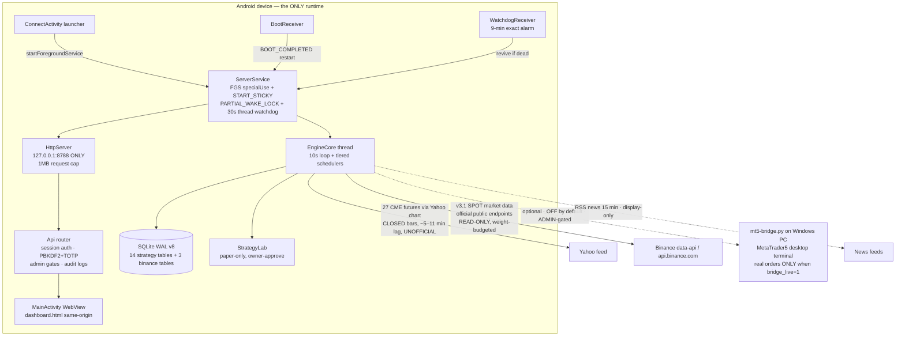

# ARCHITECTURE — AI Trading Lab Data Engine (v3.1)

Verified against source at commit `feat/v3.1-multi-broker-market-data`. Supersedes the
v1.2-era root `ARCHITECTURE.md` (kept for history).

## Type A — engine executes ENTIRELY inside the Android app

No Python at runtime. No external server required. The phone is the primary and only
operational environment (mobile-first requirement). Zero external runtime dependencies.

## v3.1 additions (multi-broker ecosystem, read-only)

| Component | File | Role |
|---|---|---|
| Binance SPOT module | `engine/BinanceMarketData.java` | dynamic universe discovery, validated klines, provenance, rate-limit handling — pure Java, host-testable |
| Binance SQLite store | `EngineCore.BinanceStore` | the ONLY place Binance rows touch the DB (`binance_symbols`, `binance_candles`, `binance_state`) |
| Broker-neutral interface | `engine/BrokerAdapter.java` | capability declarations; unknown = disabled; NO order method exists in the interface |
| Broker registry | `engine/BrokerRegistry.java` | honest inventory: YAHOO_CME_FUTURES / BINANCE_SPOT / EXNESS_MT5_BRIDGE |
| API surface | `engine/Api.java` | `/api/binance/coverage`, `/api/binance/universe`, `/api/binance/candles`, `/api/binance/watchlist` (ADMIN), `/api/brokers/registry` |
| Dashboard | `assets/dashboard.html` | Insights → 🌐 Markets chip: source health, universe search, registry |

**Hard governance boundary:** Binance rows live in separate tables and NEVER feed the
3C MASTER strategy universe (`instruments`/`candles` + `MT5_FEED` remain Yahoo/bridge).
No silent provider substitution. Strategies must be explicitly extended (with owner
review) before they may consume Binance data.

## Version / build identity

- App: `com.aitradinglab.monitor`, single-source version in `defaultConfig`.
- DB schema: v8 (v7 = QUANT PRO journal + orders; v8 = Binance registry).
- See `docs/READINESS-GATES.md` for what is verified vs NOT RUN.
